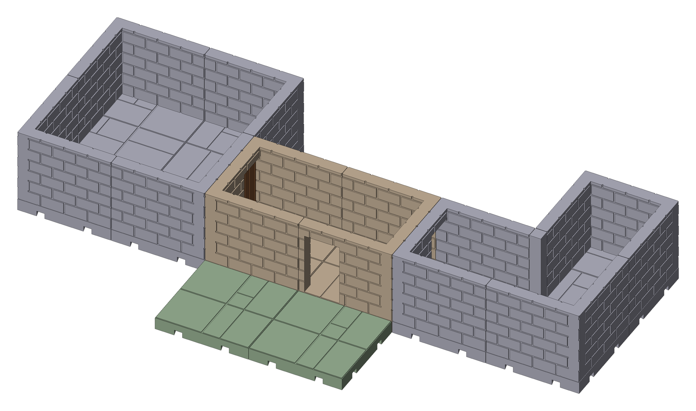
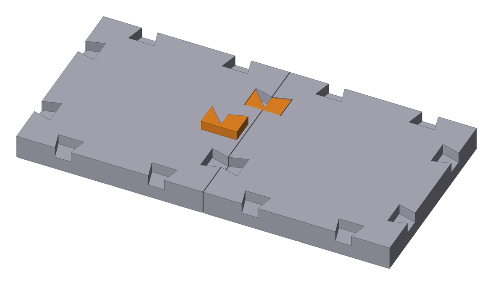
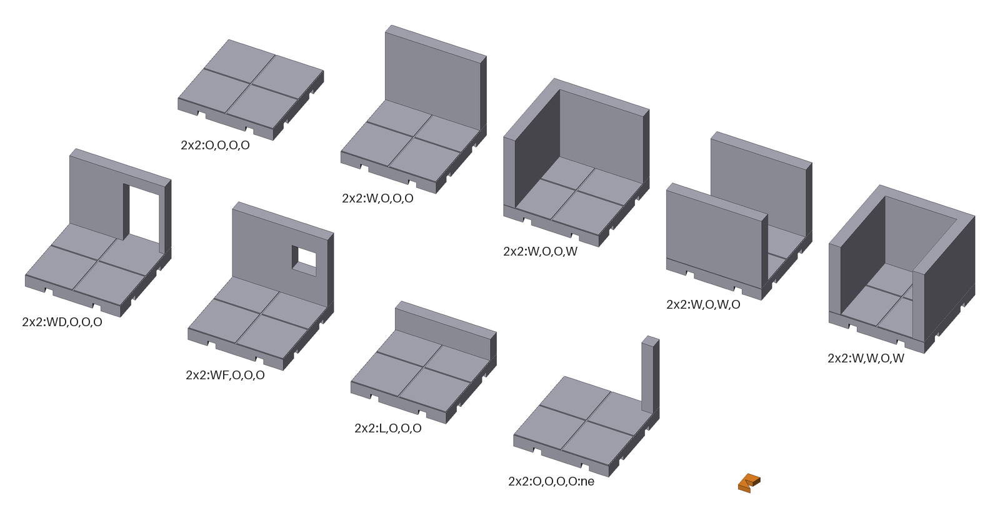
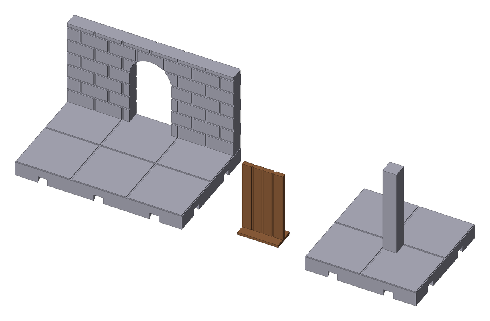
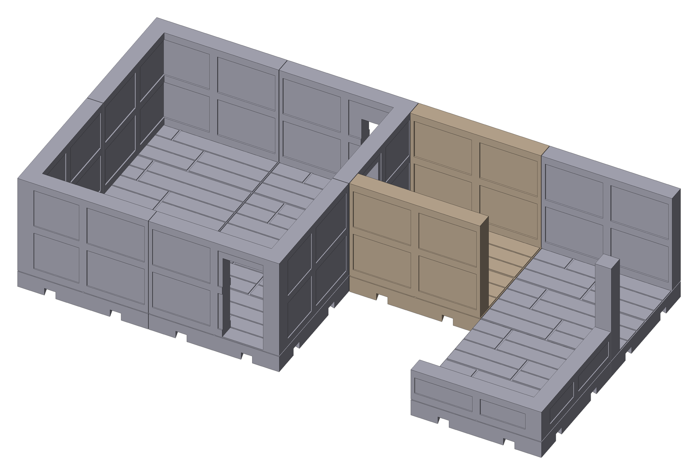

# rpgtiles

Generate 3D-printable tiles for tabletop role-playing scenes from short text specs.
Each tile is a floor slab with optional walls, doorways, arches, windows, low walls and
corner posts. Tiles share one grid and one connector, so a set can grow over time and
be combined freely. A second script plans a whole scene from a text map.



> Status: all parts generate as closed solids and the test suite passes, but nothing
> has been test-printed yet. Clip and door-leaf clearances are starting values.

## Install

```
pip install -r requirements.txt
```

Python 3 with `manifold3d` and `trimesh`; `lxml` and `networkx` are only needed for 3MF.

## Tile scheme

| Item | Default | Option |
|---|---|---|
| Grid cell | 25.4 mm (1 inch) | `--grid` |
| Base slab | 7 mm | `--base-t` |
| Wall height | 40 mm | `--wall-h` |
| Low wall height | 12.7 mm | `--low-h` |
| Wall thickness | grid / 4 | `--wall-t` |
| Clip clearance | 0.15 mm per side | `--clearance` |

- **Walls stand on the tile**, along an edge. Every tile keeps an exact grid footprint.
  Two tiles back to back give a wall of half a cell.
- **Connector**: every cell edge has the same dovetail pocket, open to the bottom. A loose
  bow-tie clip joins two tiles. Tiles can be rotated and mixed in size. The connector is
  this project's own geometry and is not OpenLOCK-compatible.
- Walls take a quarter cell of floor: keep at least 2 cells between facing walls.



## Tile specs

```
<cols>x<rows>:<N>,<E>,<S>,<W>[:<posts>]
```

Each side is one letter per cell, or one letter for the whole side. North and south
read west to east, east and west read south to north.

| Letter | Meaning |
|---|---|
| `O` | open |
| `W` | wall |
| `D` | wall with doorway |
| `A` | wall with arched doorway |
| `F` | wall with window |
| `L` | low wall |

Posts are `+`-separated: `ne`, `nw`, `se`, `sw` for the tile corners, or
`<col>.<row><corner>` for one cell (the south-west cell is `0.0`).

```
python3 rpgtiles.py 2x2:W,O,O,W 3x2:WAW,O,O,O        # room corner, wall with arch
python3 rpgtiles.py 2x2:O,O,O,O:ne --format 3mf      # floor with a corner post
python3 rpgtiles.py --set starter --out tiles/       # predefined starter set
```

Every run also writes `clip` and `door` (a loose door leaf for `D` doorways).




## Styles

```
python3 rpgtiles.py --set starter --wall-style brick --floor-style flagstone
```

- `--wall-style`: `plain`, `brick`, `planks`, `timber`
- `--floor-style`: `grid`, `flagstone`, `planks`
- `--seed`: varies the flagstone layout; the same seed gives the same tile
- `--tex-d`, `--tex-w`: groove depth and width (0.5 and 0.8 mm)

Styles are shallow cuts only, so nothing sticks out past the tile and walls print
without supports. Patterns are anchored to the grid and continue across tile joints.
A style applies to the whole run and is part of the file name.



## Planning a scene

Draw the rooms in a text file, north at the top, one character per cell:

| Character | Meaning |
|---|---|
| space | nothing |
| `a`-`z` | a room; walls appear where it borders nothing or another room |
| `A`-`Z` | same room, and this cell gets a doorway toward the neighbouring room |
| `.` | open ground without walls |

```
aaaa      bb
aaaa      bb
aaaAccccBbbb
aaaaccCcbbbb
    ....
    ....
```

```
python3 rpgscene.py example_map.txt --out scene/ --wall-style brick --floor-style flagstone
```

This writes the tile files and `scene_plan.txt` with the print list (tiles that differ
only by rotation are counted together) and the position and rotation of every tile.
The example needs 11 tiles from 7 files and is the scene shown at the top.

Tiles are cut on a 2x2 lattice from the south-west corner of the map (`--tile` changes
the size). Rooms that do not line up with it fall back to 1x1 tiles, so even room sizes
give fewer parts.

## Printing notes

- Print one clip and one 2x2 tile first and tune `--clearance`.
- Print tiles as generated, base down. Door lintels and pocket ceilings are short bridges.
- Print one brick wall before a full set; 0.5 mm grooves are fine detail for a 0.4 mm nozzle.

## Known limitations

- Single colour, single level: no stairs or platforms.
- Styles are line patterns, not rough surfaces. Brick joints do not adapt to openings,
  and the plank floor shows a seam at tile joints.
- With 40 mm walls the top brick course is a 1.9 mm sliver; `--wall-h 38.1` gives six full courses.
- A capital letter next to two other rooms gets a doorway to both.

## Development

```
python3 -m pytest -q test_rpgtiles.py
```

`CONTEXT.md` maps the files and their relationships; design decisions are recorded in
the context headers at the top of `rpgtiles.py` and `rpgscene.py`.
